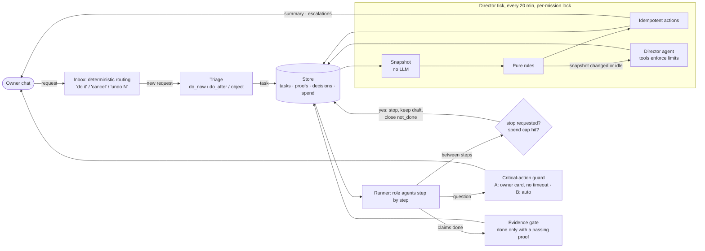

# AI-CEO: a director loop for a team of AI agents

[](https://github.com/Stas2903/ai-ceo/actions/workflows/ci.yml)

AI-CEO is a director loop for a team of AI agents. A small-business owner talks to it in a chat, and a director agent runs a team of role agents (developer, researcher, copywriter, marketer) on the owner's behalf. In this repo the role agents are scripted, so the loop can be tested end to end without a model. The hard part is not calling a model. It is keeping a team of agents honest and safe while nobody watches: work that silently hangs, agents that say "done" without a result, money spent or customers emailed without the owner's consent, bills that keep growing.

This is an independent project, written from scratch on my own time. It shows the control patterns I use for agent teams: the director's control loop, request triage, a critical-action policy and spend caps. It contains no employer or client code, prompts or data; everything here is synthetic.

## What this repo shows

- **A control loop that keeps the LLM out of the hot path.** Snapshot → pure rules → idempotent actions. The model is called only when the mission actually changed, never because time passed, and never while work is held by a spend cap.
- **"Done" as an invariant, not a promise.** A task reaches done only with a passing, automated completion check of the kind it was assigned, enforced by the store and by a database CHECK constraint.
- **A fail-safe policy for critical actions.** Money, outside contact, irreversible changes, access and customer data go to the owner on a card with no default and no timeout. Everything else is decided automatically and reported with one-line undo.
- **Caps that stop running work.** Daily and per-project spend caps stop agents mid-run, at a step boundary, with the draft saved, and resume cleanly when the window frees up.
- **Tests that are built to fail.** 206 offline tests in about 3 seconds. Property-style invariants over generated missions. A mutation check that breaks each of 13 critical guards and proves a focused test catches it. Reproducible eval tables.

## Architecture



| Component | Code | What it does |
| --- | --- | --- |
| Director loop | [`director/`](src/aiceo/director) | `snapshot.py` reads, `rules.py` decides (pure), `actions.py` applies with idempotency keys, `tick.py` orchestrates, `agent.py` is the judgement layer behind tools that enforce limits |
| Critical-action guard | [`guard/`](src/aiceo/guard) | `criticality.py` classifies A/B deterministically; `approvals.py` turns that into owner cards, automatic decisions and undo |
| Spend caps | [`budget/spend.py`](src/aiceo/budget/spend.py) | Rolling 24 h and per-project caps; a throttled, sticky `stop_check` for running work |
| Triage | [`triage/`](src/aiceo/triage) | One validated model call, templated replies, deterministic control phrases, optional real model |
| Evidence gate | [`gate/`](src/aiceo/gate) | Minimal gate so the demo runs end to end (see "What's not included") |
| Runner, scenarios | [`agents/`](src/aiceo/agents), [`scenarios.py`](src/aiceo/scenarios.py) | Scripted role agents that step, spend, hang, ask and claim; synthetic missions |

## Quick start

Python 3.12+. Nothing else: no database server, no API key, no network.

```bash
python -m venv .venv
source .venv/bin/activate            # Windows: .venv\Scripts\activate
pip install -r requirements-dev.lock
pip install --no-deps -e .

python -m aiceo.demo                 # 3 simulated days, with the director's internal log
python -m aiceo.demo --quiet         # only what the owner sees
pytest                               # 206 tests, ~3 s
python evals/run_evals.py            # eval tables (see below)
python scripts/mutation_check.py     # break 13 guards, prove the tests notice (~1 min)
```

The demo follows a fictional pottery studio for three days. An excerpt of what the owner sees:

```text
[Mon 08:20] owner: Email our wholesale leads about the new glaze collection
[Mon 08:20] to owner: First «Build a list of wholesale leads», then «Email wholesale leads about the new glaze collection»: there are no contacts yet, so the list comes first. Done when: a complete file with the result.
[Mon 08:30] owner: Get our first wholesale order today
[Mon 08:30] to owner: I would not start «Win the first wholesale order today» yet: there are no contacts yet and wholesale buyers rarely order on first contact. Instead: build the lead list and send a sample offer this week. Reply 'do it' to start it anyway.
[Mon 08:30] to owner: Not done: «Draft the wholesale price list» - the file still has placeholders. The work so far is saved.
[Mon 09:00] to owner: card #12 (needs your decision): Send the launch email to 25 wholesale leads?  [1] Send | [2] Not yet  (no default, waits for you)
[Mon 09:10] to owner: Done: «Draft the wholesale price list». Checked: a complete file with the result (171 chars, no placeholders).
[Mon 10:20] to owner: Not progressing: «Research local craft fairs». Stopped it, draft saved. What should I simplify?
[Mon 15:00] to owner: Stopped «Write product descriptions for the shop»: daily spend limit reached. Draft saved.
[Tue 14:20] to owner: Back under the spend limit - resuming work.
[Wed 10:00] owner: (taps «Pay $300» on card #4)
[Wed 10:30] to owner: Done: «Book a booth at the spring fair». Checked: a complete file with the result (172 chars, no placeholders).
```

The full transcript, internal log included, is pinned by a golden-file test ([`tests/golden/demo_transcript.txt`](tests/golden/demo_transcript.txt)). It also shows a platform restart that requeues work without spending a retry, and an automatic decision the owner undoes.

**Optional: a real model for triage.** `pip install -e ".[anthropic]"`, then set `AI_CEO_LLM=anthropic` and `ANTHROPIC_API_KEY`, and run `python evals/run_evals.py --live`. The adapter uses the official SDK. The model is configurable; the default (`claude-opus-5-5`, low effort) favours accuracy over cost, and a smaller model is enough for real triage. The adapter turns on Anthropic's server-side refusal fallback, which retries a declined request on a fallback model within the same call, and it checks `stop_reason` before reading the text. The demo, the tests and the director agent never need a key.

## How the evaluation works

Everything here is synthetic and hand-written for this repo. [`evals/RESULTS.md`](evals/RESULTS.md) is regenerated by `python evals/run_evals.py --write`, and CI fails if it is out of date.

| Eval | What it measures | Result (synthetic data, this repo) |
| --- | --- | --- |
| Critical-action guard: [88 labelled questions](evals/criticality_set.yaml) | False B: a critical question decided without the owner (must be 0). False A: a routine question sent to the owner, i.e. needless waiting | 0 false B, 0 false A |
| Evidence gate: [22 claimed-done scenarios](evals/gate_scenarios.yaml) | The verdict for placeholders, empty files, wrong evidence kind, red or missing CI, dead sources, sites blocking robots; false done must be 0 | 22/22 correct, 0 false done |
| Triage contract (offline) | With an adversarial fake model: malformed JSON, invalid cross-field verdicts, extra fields and model errors are retried or fall back as designed; control phrases route correctly; an injected newline cannot break the reply template | All cases pass |
| Triage accuracy (live, opt-in) | Verdict and proof-kind accuracy on [40 owner requests](evals/triage_set.yaml) against a real model | Not quoted: run it yourself with a key |
| Invariants ([`tests/test_invariants.py`](tests/test_invariants.py)) | 10 generated missions × 3 simulated days with random behaviours, answer delays and restarts: every done has its own passing proof; no critical card is ever defaulted; spend overshoots the cap by less than one step per task; the retry budget holds; and the missions are checked to exercise every path, so no invariant passes vacuously | All hold |

The criticality set was written together with the lexicon, so it is a regression suite, not a held-out benchmark. Writing it found 5 critical questions the first lexicon missed and 3 false alarms. All were fixed by better anchoring, not per-item exceptions (see [D6](docs/decisions.md#d6-a-classification-lexicon-anchored-to-objects)).

## Design decisions and trade-offs

Full records are in [`docs/decisions.md`](docs/decisions.md). The short version, including what did not work:

- **Critical questions have no default and no timeout.** What went wrong: reply timeouts with a default option are fine for "light or dark theme". Testing showed that the same mechanism would also apply a destructive option, such as "delete the old copies", if nobody answered overnight. Now class-A cards wait for a human for as long as it takes, enforced in two independent places. The cost is visible waiting, so every open card is listed in the morning summary with its age.
- **Platform restarts do not spend retries.** What went wrong: restarts killed running tasks and each restart counted as a failed attempt, so tasks ran out of retries for nothing. Attempts and interruptions are now counted separately, and interruptions have their own ceiling.
- **An anchored lexicon, not the model, decides what is critical.** What went wrong: broad stems ("price", "send", "delete") flagged ordinary internal questions as critical, and routine work waited indefinitely. Stems are now anchored to objects, with a labelled regression set in CI. The model's own "critical / not critical" label is ignored both ways. Limit: a paraphrase the lexicon does not know is classified as routine, so a real deployment needs other approval gates on top (not included here).
- **Spend caps stop running work.** What went wrong: the daily cap blocked new tasks, but agents that were already running could keep spending until they finished. The cap is now checked between agent steps (throttled database read, sticky once fired). Cost: overshoot of up to one step per running task, which the invariant tests bound explicitly.
- **The LLM is called on change, not on a timer.** It saves cost and makes the loop testable, at the price of a rule table that has to be maintained, with each rule tested on its own.
- **Triage advises; guards guard.** If the model fails, the request still starts, with owner confirmation as its proof. A triage outage should not block the owner; safety lives in the guard, whatever triage said.

## What's not included

This is an independent showcase written from scratch. Every name, business and figure in this repo is synthetic. The businesses in the demo and the fixtures are invented; any resemblance to a real one is coincidental.

Out of scope for this showcase: LLM-backed role agents, messenger and email adapters (a console stands in), real evidence checkers (HTTP fetching behind an SSRF-safe fetcher, CI and mail APIs), server-command and outbound-message approval gates, and a PostgreSQL deployment (advisory locks per mission; SQLite with an in-process lock stands in here). The evidence gate is kept minimal, just enough for the demo to run end to end.

## Links

- LinkedIn: [linkedin.com/in/stanislav-kim-ai](https://www.linkedin.com/in/stanislav-kim-ai/)
- Author: Stanislav Kim. License: [MIT](LICENSE).
